<div align="center">

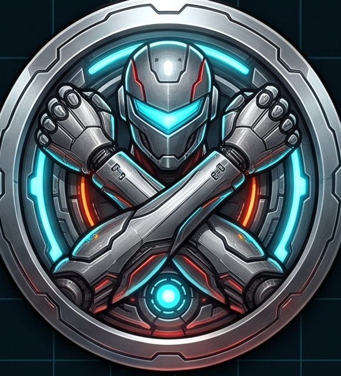

# ARBITER DOJO

**A 2.5D browser fighter whose opponent is a real decision kernel — not a script.**

Next.js 16 · TypeScript · WebAssembly · Canvas 2D · Playwright

</div>

---

## What is this?

**Arbiter Dojo** is a 2.5D fighting game that runs entirely in the browser. You play **Kaito Ren**; your opponent is **VX-9 "Arbiter"**, a combat android whose mind is the **OmniDecide v2.0.0 decision kernel**, compiled to WebAssembly and running locally on every frame.

Three design pillars set it apart:

| | |
|---|---|
| **It reads you** | The Arbiter profiles your habits from what it *sees*: your openers, your lows, your wake-up answers. Difficulty changes how fast it reacts, not what it knows. |
| **It never cheats** | The AI is architecturally forbidden from reading your input buffer. It only observes the same game state a human sees on screen. |
| **It explains itself** | Press **F1** in a fight to open the kernel trace: every decision the kernel made, with confidence and timing. |

And it **learns**: every fight — yours *and* its own 100-match self-play training — is fed into an experience brain that biases future choices toward what worked.

## Screenshots

| | |
|---|---|
| 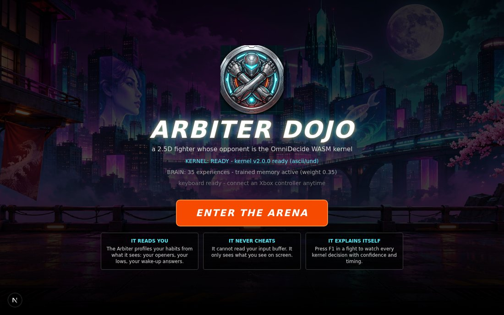 | 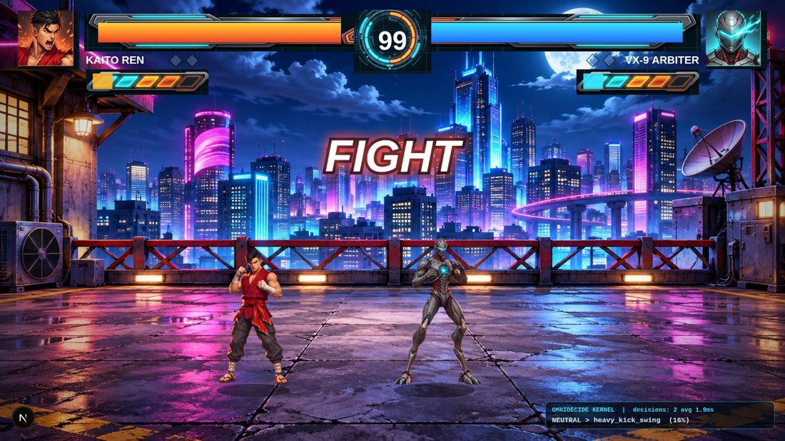 |
| Title screen — kernel v2.0.0 ready, trained memory active | VS intro on the Neon Rooftop stage |
| 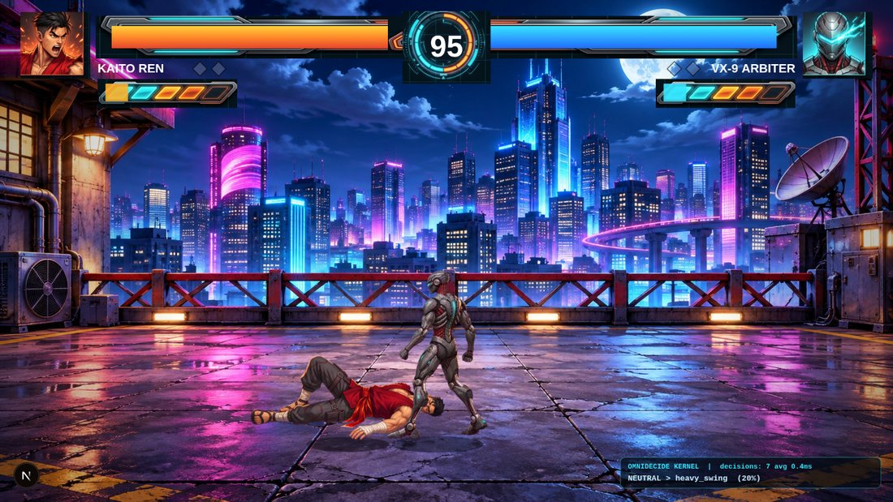 | 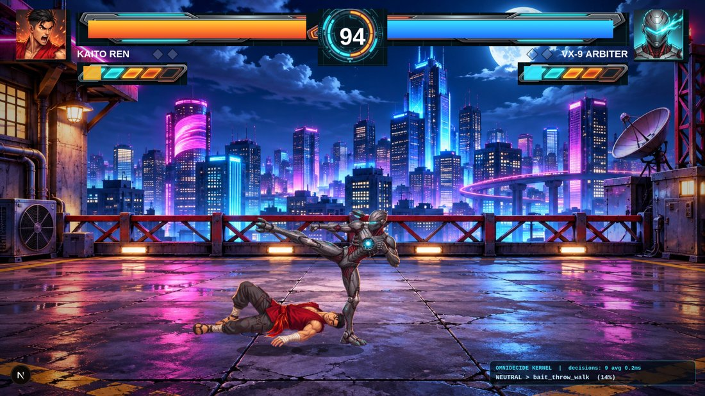 |
| Mid-fight: six-button combat at 60 fps | Heavy kick answer — note VX-9's 10% larger frame |
| 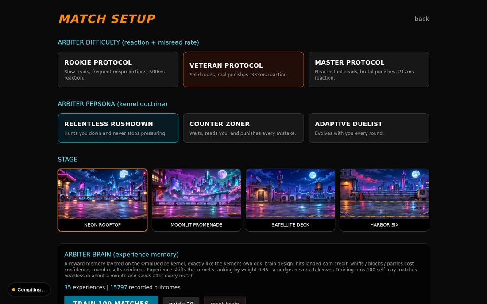 | 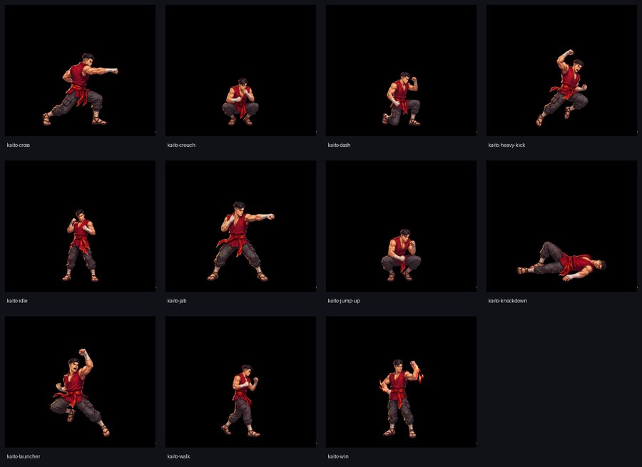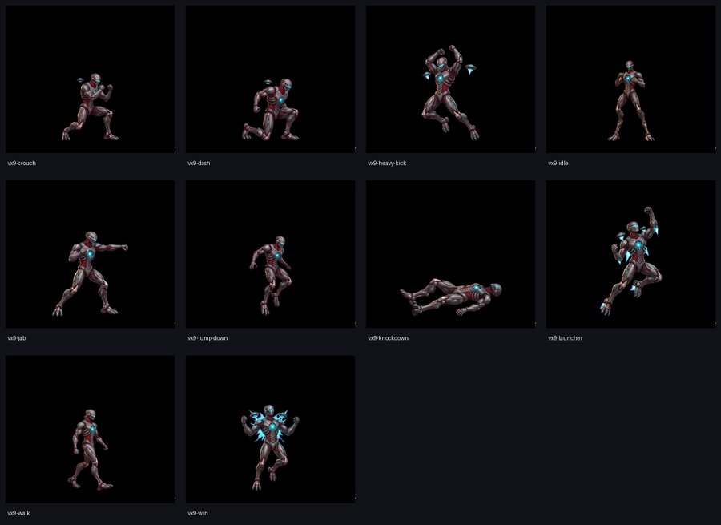 |
| Match setup — difficulty, persona, stage, and the training console | Pose sheets: Kaito Ren and the 10% larger VX-9 Arbiter |

## Controls

| Input | Action |
|---|---|
| `← →` / `A D` | Walk (double-tap forward = dash, double-tap back = backdash) |
| `↑` / `W` | Jump |
| `↓` / `S` | Crouch (crouch + back = low guard) |
| hold back | **Guard** — blocks highs and mids (crouching, blocks lows) |
| `J` / `K` / `L` | Light / Medium / Heavy **punch** |
| `U` / `I` / `O` | Light / Medium / Heavy **kick** |
| forward + `L` | **Rising Fang** — anti-air launcher, combo starter |
| `B` | **Throw** (beat block; press `B` within 10f of being thrown to tech) |
| `N` | **Drive Impact** — armored, knockdown, costs 25 drive |
| `M` | **Parry** |
| `ESC` | Pause |
| `F1` | Kernel decision trace |

An Xbox-style gamepad is supported through the standard Gamepad API mapping — the same six-button layout on face buttons.

## The Arbiter's mind

Every ~13–30 frames (depending on difficulty) the AI runs a four-stage pipeline. The heavy lifting happens inside the WASM kernel; the host adds perception noise and executes commands.

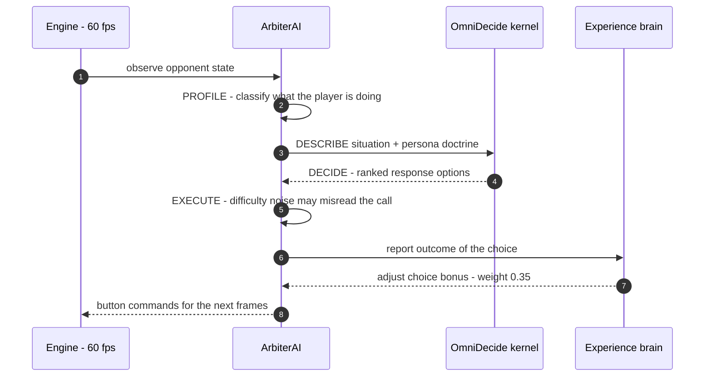

### Difficulty — reaction time and misread rate, nothing else

| Tier | Reaction | Misread chance | Combo depth |
|---|---|---|---|
| `ROOKIE PROTOCOL` | 500 ms (30f) | 35% | 1 |
| `VETERAN PROTOCOL` | 333 ms (20f) | 15% | 2 |
| `MASTER PROTOCOL` | 217 ms (13f) | 4% | 3 |

### Persona doctrine

| Persona | Doctrine |
|---|---|
| `RELENTLESS RUSHDOWN` | Hunt the opponent down. Deny space, close gaps fast, never stop pressuring. |
| `COUNTER ZONER` | Hold ground. Control space, block deliberately, punish every mistake. |
| `ADAPTIVE DUELIST` | Mirror and exploit. Match the opponent's energy: press when they press, breathe when they breathe. |

### Fair-play rules

1. The AI never reads `keydown` events, the input buffer, or anything the player pushed. It reads **engine state only** — positions, states, hitboxes, what is on screen.
2. Difficulty knobs are reaction interval, perception noise, and combo depth. The kernel itself is identical at every tier.
3. Every kernel call is logged and viewable in-game (`F1`) — including the ones where it was wrong.

## The brain — 100 matches of self-play training

The experience brain is a faithful host-side port of the kernel's learning module (`odk-brain/odk_learn.c`): it stores per-choice win/loss records and blends a bonus into future decisions at **weight 0.35**.

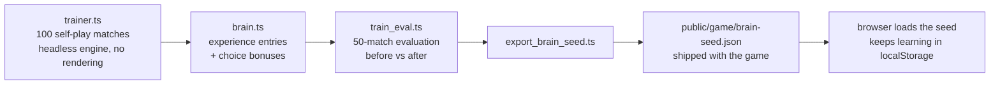

The shipped brain was trained by making the AI fight **itself for 100 matches** — the trainee against a rotating gauntlet of persona/difficulty opponents — using the deterministic engine in headless mode (no rendering, ~8 s wall time). The brain gained **35 experience entries** over **16,974 visits**.

### Did it work?

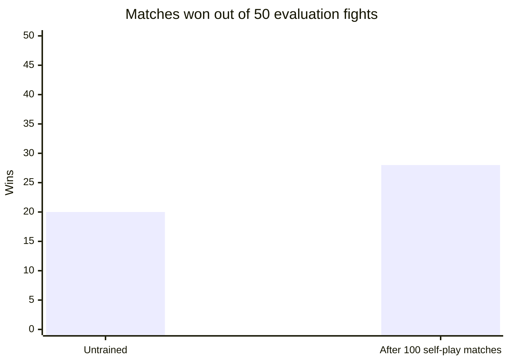

Evaluation of the trained brain, 50 matches each:

| | Wins | Losses | Draws | HP differential |
|---|---|---|---|---|
| Before training | 20 | 29 | 1 | −5053 |
| **After training** | **28** | **22** | **0** | **+2859** |

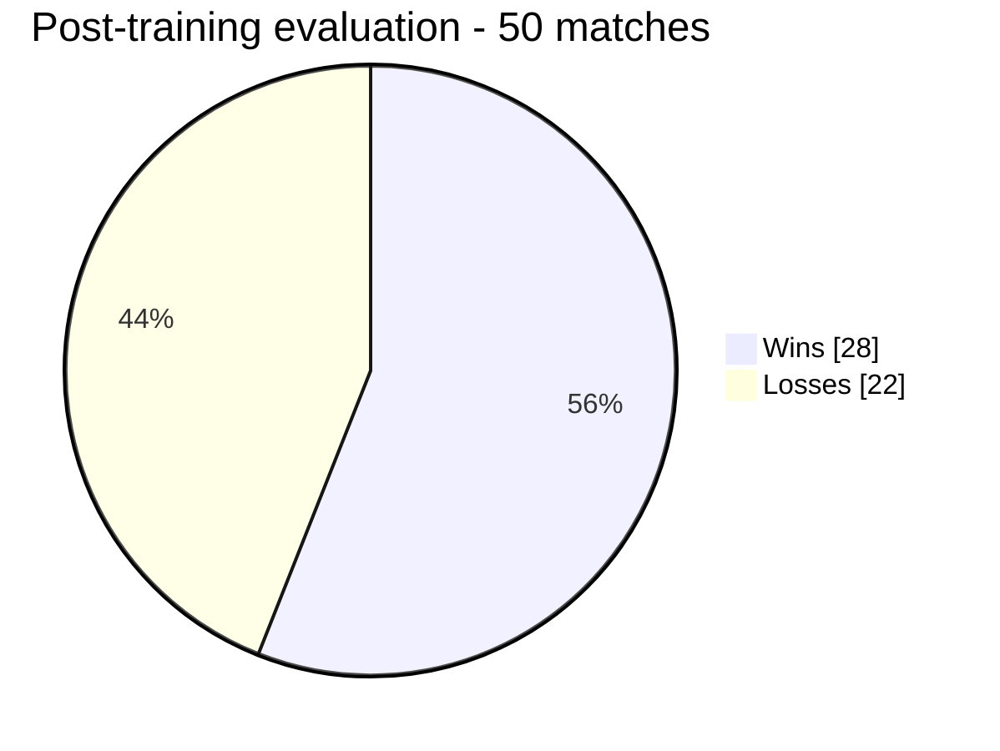

### Top lessons the brain actually uses

| Situation | Choice | Record | Success |
|---|---|---|---|
| Anti-air | `anti_air_launcher` | 103 W – 2 L | 98.1% |
| Anti-air | `anti_air_heavy` | 373 W – 10 L | 97.4% |
| Anti-air | `block_low` | 170 W – 15 L | 91.9% |

The brain persists to `localStorage` under the key `arbiter_brain_v1` — it keeps learning from *your* fights, and the Match Setup screen can reset it or re-run training live in the browser.

## Combat system

A classic six-button layout — three punches, three kicks, each in a light/medium/heavy weight. Punches are the fastest buttons and chain well; kicks hit harder and reach further; heavies must be spaced or punished. Frame data follows standard fighting-game conventions (Infil's glossary, SuperCombo SF6 data as references).

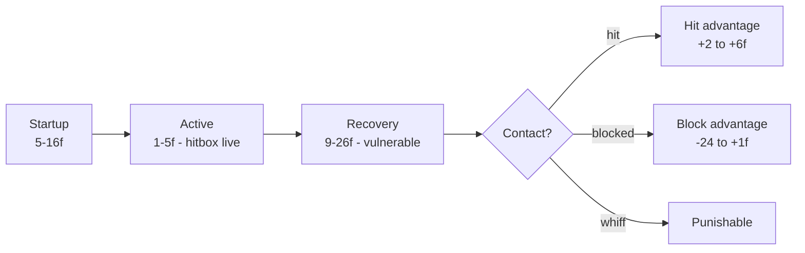

Standing frame data (the shared rulebook in `src/game/moves.ts`):

| Button | Move | Startup | Damage | Reach | On block | Notes |
|---|---|---|---|---|---|---|
| `J` | Jab | 5f | 40 | 150 | +1 | fastest poke, plus on block |
| `K` | Palm Strike | 10f | 80 | 175 | −3 | |
| `L` | Skullcracker | 13f | 115 | 165 | −8 | heavy flash |
| fwd + `L` | Rising Fang | 14f | 70 | 155 | −24 | launcher — anti-air / combo starter |
| `U` | Snap Kick | 6f | 45 | 160 | −1 | |
| `I` | Rush Knee | 11f | 85 | 185 | −4 | |
| `O` | Heavy Heel | 16f | 120 | 195 | −10 | knockdown |
| `B` | Throw | 5f | 130 | 105 | — | beats block; 10f tech window |
| `N` | Drive Impact | 20f | 100 | 215 | −18 | armor f3–16, knockdown, 25 drive |

Six crouching variants (including **Ankle Sweep**, low knockdown) and six air variants (all overheads) complete the 20-move kit. **Lows must be blocked crouching; overheads standing.**

### Drive gauge

The gauge starts at 50 (max 100) and regenerates slowly. Spending it: **Forward Rush** (25) and **Drive Impact** (25). Hitting builds meter; getting hit drains it.

### Every body is not the same size

VX-9 is a heavier combat frame — **10% larger than Kaito** (`CHAR_SCALE` in `src/game/types.ts`). The single factor drives both the rendered sprite size (all 21 poses) and the physics: hurtbox height, throw reach, and pushbox all scale with it, so the bigger silhouette is a real, consistent hitbox.

## Architecture

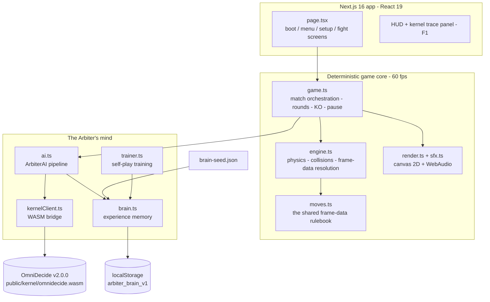

The engine is **deterministic and rendering-free** — the same code that runs the fight in your browser runs the AI's 100-match training headless, which is what keeps training honest and fast.

| Module | Role |
|---|---|
| `src/app/page.tsx` | Screens (boot → menu → setup → fight), HUD overlays, training console |
| `src/game/engine.ts` | Movement, collisions, frame-data resolution, drive, throws, guard |
| `src/game/game.ts` | Match flow: rounds, KO, timer, win screen, input routing |
| `src/game/ai.ts` | ArbiterAI: profile → describe → decide → execute pipeline |
| `src/game/kernelClient.ts` | Loads `omnidecide.wasm`, wraps `evaluateChoice` calls |
| `src/game/brain.ts` | Experience memory (port of the kernel's `odk_learn.c`) |
| `src/game/trainer.ts` | Self-play: two ArbiterAI instances sharing one brain |
| `src/game/moves.ts` | The 20-move frame-data rulebook |
| `src/game/types.ts` | Shared types, `CHAR_SCALE` size system |
| `src/game/render.ts` | Canvas 2D renderer: poses, VFX, shadows, HUD art |
| `src/game/sfx.ts` | WebAudio sound effects |
| `public/kernel/` | OmniDecide v2.0.0 WASM kernel + API shims |

## Getting started

**Prerequisites:** [Bun](https://bun.sh) (or Node 20+), any modern browser.

```bash
bun install        # install dependencies
bun run dev        # http://localhost:3000
```

Production build:

```bash
bun run build      # next build (standalone output)
bun run start      # serves the standalone server
```

The game boots through a short asset/kernel load, then you are at the title screen. The shipped brain (`public/game/brain-seed.json`) is loaded automatically — the Arbiter is already trained, and it keeps learning from your fights.

## Testing

The Playwright suite drives the real game in a real browser — no mocks:

| Suite | Covers |
|---|---|
| `e2e/gameplay.spec.ts` | Boot → menu → fight flow, round/KO/match resolution, all six attack buttons, throw, drive impact, guard, pause |
| `e2e/brain-training.spec.ts` | Live 100-match training in the browser, brain persistence to `localStorage` |
| `e2e/size-consistency.spec.ts` | VX-9 renders and collides at exactly 1.10× Kaito's scale across poses |
| `e2e/stress.spec.ts` | 60 fps budget, kernel latency, 10-minute soak, heap stability |

```bash
bun run dev        # terminal 1 - the suite reuses the dev server on :3000
bunx playwright test   # terminal 2
```

## Project structure

```
arbiter-dojo/
├── src/
│   ├── app/                  # Next.js app: page.tsx, layout, api route
│   ├── game/                 # the game: engine, ai, brain, trainer, render...
│   ├── components/ui/        # shadcn/ui primitives
│   └── lib/
├── public/
│   ├── game/
│   │   ├── assets/           # 42 poses, stages, VFX, UI art, manifest.json
│   │   └── brain-seed.json   # the shipped trained brain
│   └── kernel/               # OmniDecide v2.0.0 WASM kernel + shims
├── e2e/                      # Playwright suites
├── scripts/                  # training, capture, calibration tooling
├── docs/screenshots/         # README screenshots
└── prisma/                   # schema for the (optional) api route
```

## Tooling scripts

| Script | What it does |
|---|---|
| `scripts/train_eval.ts` | Headless 100-match self-play training + before/after evaluation |
| `scripts/export_brain_seed.ts` | Exports the trained brain to `public/game/brain-seed.json` |
| `scripts/capture_fight.ts` | Playwright capture of live fight screenshots |
| `scripts/capture_menu.ts` | Playwright capture of the title screen and training console |
| `scripts/prep_doc_shots.py` | Resizes/optimizes captures into `docs/screenshots/` |
| `scripts/apply_calibration.py` | Applies sprite calibration to the asset manifest |
| `scripts/scale_vx9_manifest.py` | Applies the 1.10× size factor to all VX-9 poses |

---

<div align="center">

*Enter the arena. It has already read you.*

</div>
